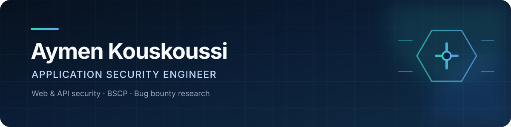

<p align="center">
  
</p>

<p align="center">
  <a href="https://portswigger.net/web-security/certification">
    
  </a>
  <a href="https://yeswehack.com/hunters/killerlux">
    
  </a>
  <a href="https://yeswehack.com/hunters/killerlux">
    
  </a>
</p>

<p align="center">
  <a href="https://yeswehack.com/hunters/killerlux">YesWeHack</a>
  &nbsp;&middot;&nbsp;
  <a href="https://www.linkedin.com/in/aymen-kouskoussi/">LinkedIn</a>
  &nbsp;&middot;&nbsp;
  <a href="mailto:aymenkouskoussi@gmail.com">Email</a>
</p>

I am a BSCP-certified application security engineer focused on web and API security. I have earned more than EUR25,000 in bug bounty rewards across 41+ rewarded vulnerabilities, with a Top 10 finish on YesWeHack in Q2 2026.

My work covers authorization flaws, business logic, API testing, exploit validation and remediation. I also build small tools that remove repetitive work from security research.

## Selected work

| Project | What it does | Stack |
| --- | --- | --- |
| [YesWeHack new-program watcher](https://github.com/killerlux/yeswehack-new-program-watcher) | Detects newly published public programs by stable identity and sends Telegram or Discord alerts. Runs on a five-minute GitHub Actions schedule. | Python, pytest, GitHub Actions |
| [Security monitoring agent](https://github.com/killerlux/security-monitoring-agent) | Monitors Linux hosts and adds HTTP/TLS checks, SBOM and CVE scanning, lightweight DAST, and CI policy gates. | Python, Shell, OWASP ZAP |
| [Tech jobs notifier](https://github.com/killerlux/techjobs-notifier) | Collects and deduplicates recent entry-level technical roles across Europe, then refreshes the public dataset automatically. | JavaScript, GitHub Actions |
| [Taxi platform architecture](https://github.com/killerlux/kouskous) | Documents a ride-hailing system with separate client, driver, dispatch and administration services, plus infrastructure and security controls. | NestJS, Flutter, PostGIS, Redis, Terraform |

## Security focus

```text
Web and API testing       Burp Suite, access control, business logic, HTTP
Security engineering      Threat modeling, hardening, vulnerability management
Cloud and identity        Azure / Entra ID, IAM, RBAC, Terraform
Automation                Python, Bash, JavaScript, GitHub Actions
```

## Beyond the report

I write reproducible findings, verify impact end to end, and give engineering teams concrete remediation steps. The same approach shapes the tools and reference architectures in my public repositories.
